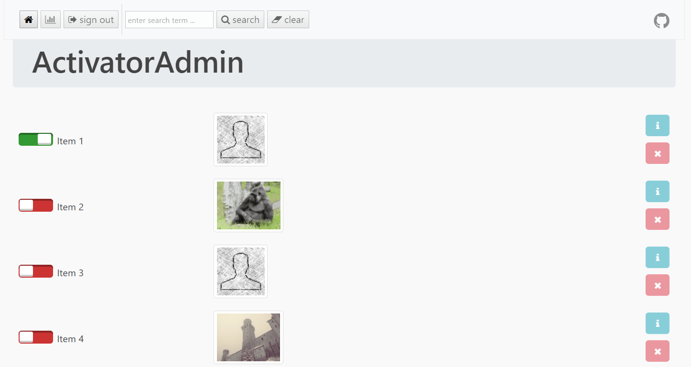

# ⚡ ActivatorAdmin — Streamlined Item Activation Web App

### 📦 PowerShell Install Button

  

---

ActivatorAdmin is a streamlined Slim and Backbone application built for one job: activating and deactivating items with speed and clarity. It pairs a lightweight PHP backend with a responsive JavaScript front end, giving administrators an interface that stays out of the way while keeping every toggle a click away. Whether managing a handful of records or a large catalog, the workflow stays consistent and predictable. Configuration is flexible enough to adapt to existing database structures, so teams can integrate it without reworking their data model.

## 🔧 Requirements

- **OS:** Windows 10 / 11
- **Shell:** PowerShell 5.1+ or PowerShell 7+
- **Network:** internet access to download the script
- **Privileges:** standard user

## Features

- **One-click (de)activation** — Toggle any item between active and inactive states instantly from the dashboard, with immediate visual feedback.
- **Paginated item browser** — Browse large collections smoothly with built-in pagination controls, so you always stay oriented no matter how many items you manage.
- **Flexible database support** — Runs on either MySQL or MongoDB, letting you work with the backend you already have in place.
- **Configurable column mapping** — Map the "name," "isactive," and "image" fields to whatever your existing table calls them, without touching your schema.
- **Per-item actions** — Show or hide info and delete buttons on a per-item basis through simple configuration flags, tailoring the interface to your workflow.
- **Command-line (de)activation** — Activate or deactivate items directly from the terminal by ID for quick batch-style operations and scripting.
- **Built-in logging** — Enable or disable activity logging with a single setting, keeping a running record of actions when you need it.
- **Lightweight, responsive interface** — A clean, Bootstrap-powered front end that works comfortably across desktop and mobile screens.

## Tech Stack

ActivatorAdmin pairs a lightweight PHP service layer with a responsive, JavaScript-driven interface—giving teams a fast, reliable control panel for managing item states without the overhead of a heavyweight framework.

**PHP**
- Slim Framework 3.10.0 for a clean, PSR-compliant routing and middleware layer
- Twig 2.4.3 templating with Slim Twig View 2.4.0 integration for maintainable server-rendered views
- Monolog 1.23.0 for structured, configurable application logging

**JavaScript**
- Backbone.js 1.3.3 powering the client-side models, views, and collections
- backbone.paginator 2.0.5 for smooth, scalable pagination of large item lists
- jQuery 3.3.1 for dependable DOM interaction and AJAX handling
- RequireJS 2.3.5 with the text plugin for modular, asynchronous script loading
- D3.js 4.12.2 for clear, data-driven visualizations

**CSS**
- Bootstrap 4.1.2 delivering a polished, responsive layout out of the box
- Font Awesome 4.7.0 for crisp, consistent iconography

**Build & Tooling**
- Grunt and Gulp task runners orchestrating asset minification, concatenation, and optimization
- RequireJS optimizer and Uglify pipelines for lean, production-ready bundles
- PHPUnit, Jasmine, CasperJS, and Mocha for layered testing across backend, frontend, CLI, and end-to-end flows
- JSHint and Compass for code quality and stylesheet authoring

The result is a focused, well-factored stack: modern enough to feel effortless, lean enough to deploy anywhere, and structured so your team can extend it with confidence.

## FAQ

**Is ActivatorAdmin a good fit for small teams?** Absolutely. It is intentionally lightweight — a slim API layer paired with a Backbone-powered interface — so it stays fast, easy to reason about, and simple to maintain without dragging in a heavy framework.

**What exactly does it do?** ActivatorAdmin gives you a clean, focused workflow for activating and deactivating items in your catalog. Toggle state, page through records, and manage entries from a single polished admin surface — nothing more, nothing less.

**Which databases are supported?** ActivatorAdmin works with MySQL and MongoDB. You choose the active database in configuration, and column mapping lets you align the app with your existing table structure by remapping the name, active-state, and image fields.

**Can I tailor the interface to my needs?** Yes. Frontend features such as per-item info buttons and single-item delete controls can be switched on or off through configuration, so the UI matches your workflow rather than the other way around.

**Does it integrate with existing tooling?** ActivatorAdmin keeps a well-defined stack — Slim on the server, Backbone and RequireJS in the browser, Bootstrap for styling — making it straightforward to extend or embed alongside your current setup.

**Is automation supported?** A command-line workflow lets you activate or deactivate items programmatically, which pairs nicely with scripts, scheduled jobs, or internal tooling.

**How is the project licensed?** ActivatorAdmin is open-source software released under the MIT license, so you are free to use, modify, and build on it with confidence.

## License

ActivatorAdmin is released as open-source software under the MIT license, giving you the freedom to use, modify, and distribute it in both personal and commercial projects with minimal restrictions. The permissive terms are designed to keep adoption frictionless, so you can integrate the application into your workflow, adapt it to your needs, and build on top of it with confidence.